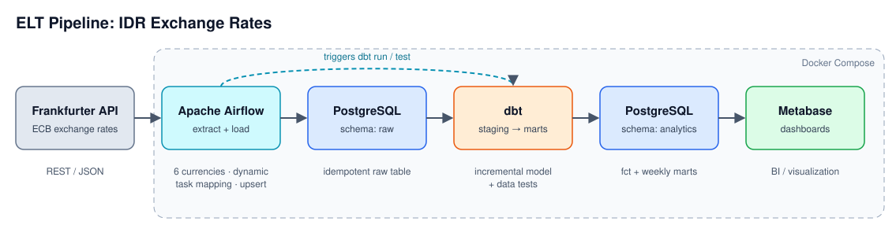
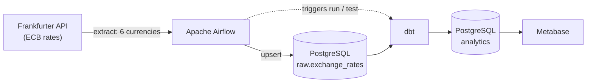
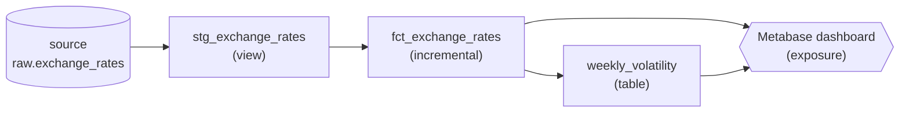

# IDR Exchange Rate ELT Pipeline

An end-to-end, containerized **ELT pipeline** that collects daily foreign-exchange rates against the
Indonesian Rupiah (IDR), models them with **dbt**, orchestrates everything with **Apache Airflow**, and
serves dashboards in **Metabase**. Everything runs locally with a single `docker compose up`.



## Highlights

- **Orchestration**: Airflow DAGs with dynamic task mapping (one task per currency), retries, and a separate parameterized backfill DAG.
- **Idempotent loads**: upserts on a composite primary key, so any run can be repeated without duplicates.
- **dbt layered modeling**: `source → staging (view) → marts (incremental + table)`.
- **Incremental model**: `delete+insert` with a lookback window so window functions (`lag`, moving average) stay correct.
- **Data quality**: dbt tests (`not_null`, `accepted_values`, `unique_combination_of_columns`) run after every load; source freshness is configured.
- **Documentation as code**: every model/column described, lineage graph and an exposure for the Metabase dashboard.
- **CI**: GitHub Actions checks DAG syntax and runs `dbt parse` on every push.

## Architecture



### dbt lineage



## Tech stack

| Layer | Tool |
|---|---|
| Orchestration | Apache Airflow 2.10 |
| Transformation | dbt-core 1.8 + dbt-postgres |
| Warehouse | PostgreSQL 15 |
| BI | Metabase |
| Packaging | Docker, Docker Compose |
| CI | GitHub Actions |
| Source | [Frankfurter API](https://frankfurter.dev) (no API key needed) |

## DAGs

| DAG | Purpose | Schedule |
|---|---|---|
| `kurs_pipeline` | Extract the last 7 days, `dbt run` (incremental), `dbt test` | Weekdays 08:00 |
| `kurs_backfill` | Load a historical date range, `dbt run --full-refresh`, `dbt test` | Manual (params: `start_date`, `end_date`) |

## Data model

| Model | Type | Description |
|---|---|---|
| `stg_exchange_rates` | view | Cleaned raw data (invalid rates removed) |
| `fct_exchange_rates` | incremental | Daily rate, daily change (abs/%), 7-day moving average |
| `weekly_volatility` | table | Weekly avg / min / max / standard deviation per currency |

## Design decisions

- **ELT instead of ETL**: raw data is loaded untouched, transformations live in SQL inside the warehouse (dbt), which keeps them testable and version-controlled.
- **Upsert on `(rate_date, base_currency, target_currency)`**: makes re-runs and overlapping 7-day windows safe.
- **Backfill in 60-day chunks**: for long ranges the API may return aggregated (weekly) data; short chunks keep daily granularity.
- **Lookback in the incremental model**: the model re-reads 21 days and rewrites 7, so `lag()` and the moving average have context and late revisions are captured. After a backfill, `--full-refresh` is required (done automatically by `kurs_backfill`).
- **dbt in an isolated virtualenv**: avoids dependency conflicts with Airflow. `dbt-core` is pinned because an unpinned install can pull a newer major version without Postgres support.

## Project structure

```
.
├── dags/
│   ├── kurs_common.py        # shared extract/load logic and dbt command helpers
│   ├── kurs_pipeline.py      # daily DAG
│   └── kurs_backfill.py      # parameterized backfill DAG
├── dbt_project/
│   ├── dbt_project.yml
│   ├── profiles.yml          # credentials via env vars
│   ├── packages.yml          # dbt_utils
│   └── models/
│       ├── staging/          # sources.yml, stg_exchange_rates.sql, schema.yml
│       ├── marts/            # fct_exchange_rates.sql, weekly_volatility.sql, schema.yml
│       └── exposures.yml     # Metabase dashboard
├── docs/
│   ├── architecture.svg
│   └── images/               # screenshots
├── .github/workflows/ci.yml
├── docker-compose.yml
├── Dockerfile
├── init-db.sql
└── .env.example
```

## Quick start

Requirements: Docker Desktop (Compose v2).

```bash
cp .env.example .env            # Windows: copy .env.example .env
docker compose up -d --build
docker compose exec airflow cat /opt/airflow/standalone_admin_password.txt
```

| Service | URL |
|---|---|
| Airflow (user `admin`) | http://localhost:8080 |
| Metabase | http://localhost:3000 |
| dbt docs (on demand) | http://localhost:8081 |

1. In Airflow, trigger **`kurs_backfill`** (*Trigger DAG w/ config*) with `start_date` e.g. `2025-01-01`.
2. Enable **`kurs_pipeline`** for the daily schedule.
3. In Metabase, add a PostgreSQL database: host `postgres`, port `5432`, db `warehouse`, user/password from `.env`; then sync the schema.

### dbt documentation and lineage graph

```bash
docker compose --profile docs up dbt-docs
```
Open http://localhost:8081 and click the **lineage graph** icon (bottom right) to see
`source → staging → marts → dashboard`.

### Example dashboard queries (Metabase → New → SQL query)

```sql
-- Rate trend (line chart: x=rate_date, y=idr_rate, series=base_currency)
select rate_date, base_currency, idr_rate
from analytics.fct_exchange_rates
where base_currency in ('USD','EUR','SGD','AUD')
order by rate_date;

-- 7-day moving average vs. actual (USD)
select rate_date, idr_rate, moving_avg_7d
from analytics.fct_exchange_rates
where base_currency = 'USD' order by rate_date;

-- Weekly volatility (bar chart)
select week_start, base_currency, volatility
from analytics.weekly_volatility order by week_start;

-- Largest daily moves
select rate_date, base_currency, idr_rate, change_pct
from analytics.fct_exchange_rates
order by abs(change_pct) desc nulls last limit 20;
```

## Screenshots

| Airflow DAG | dbt lineage graph |
|---|---|
|  |  |

| Metabase dashboard | dbt tests passing |
|---|---|
|  |  |

## Stopping

```bash
docker compose down       # keep data
docker compose down -v    # remove all data (Postgres + Metabase)
```

## Possible extensions

- Astronomer Cosmos: render each dbt model as its own Airflow task
- Slack/Telegram alerts on DAG failure
- `dim_currency` dimension and dbt snapshots
- Deploy to a small cloud VM with managed Postgres
